# RefreshGlobal — « Toutes les boîtes » pour FreeScout

> **Dépôt** : https://github.com/00MY00/RefreshGlobal

[English version](README.en.md)

## 1. Présentation

RefreshGlobal est un module pour [FreeScout](https://freescout.net) qui ajoute une page **« Toutes les boîtes »** :
les tickets de toutes les boîtes auxquelles vous avez accès, dans une seule liste, avec un filtre par boîte.
Les tickets restent dans leur boîte : un clic ouvre la page normale du ticket, et la réponse part donc avec
l'adresse de la bonne boîte. Si le module [Refresh](https://github.com/altmenorg/freescout-refresh) est installé,
la page a exactement son apparence ; sinon elle utilise le style standard de FreeScout.

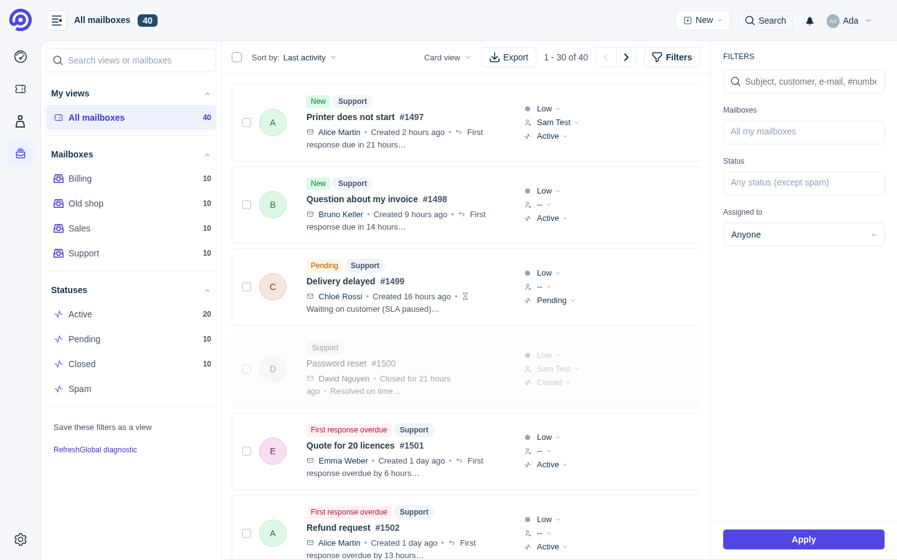

| Filtres par boîte et statut | Vue tableau |
|---|---|
| 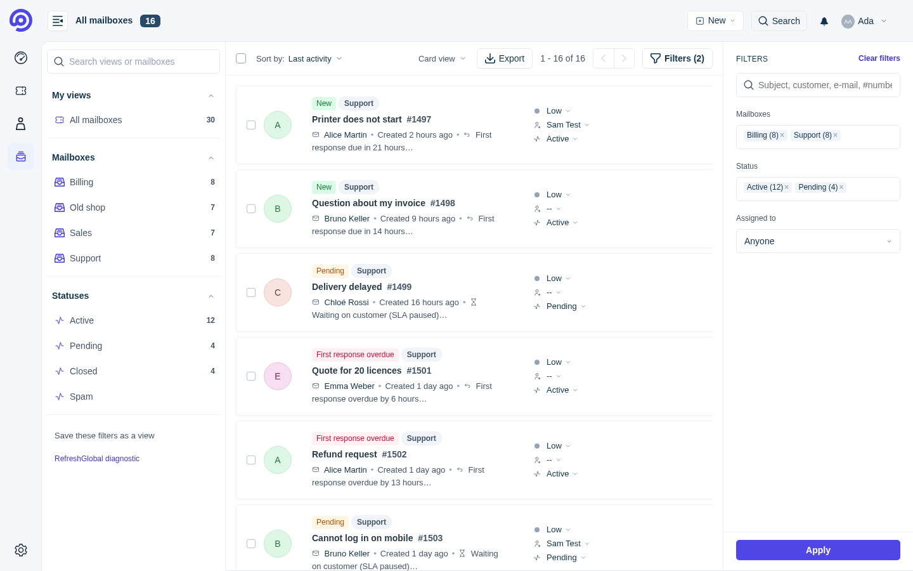 | 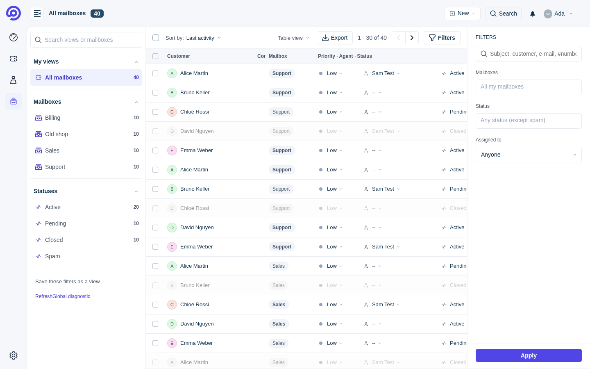 |

Sur téléphone (avec Refresh) : l'entrée « Toutes les boîtes » en tête du tiroir des vues (☰), la liste, et le tiroir de la page (boîtes, statuts, export, vues enregistrées).

| Tiroir de Refresh | Liste | Tiroir de la page |
|---|---|---|
| 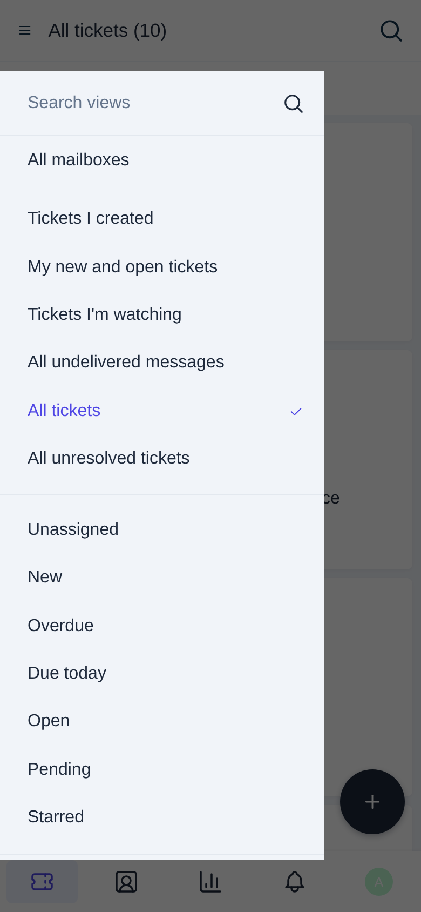 | 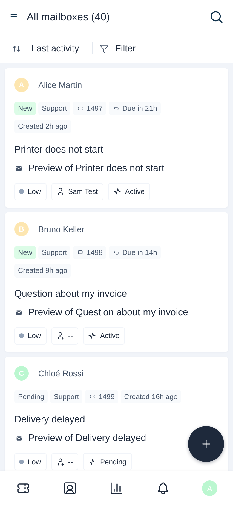 | 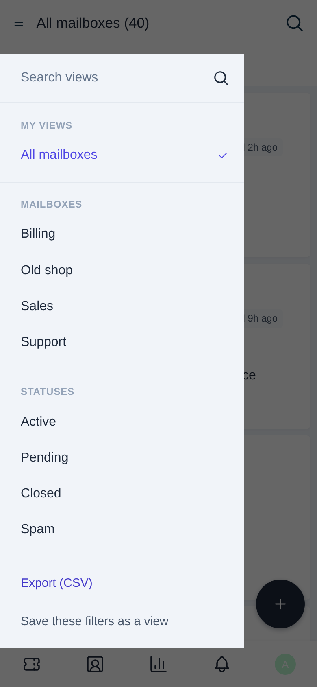 |

Dans Gérer › Modules :

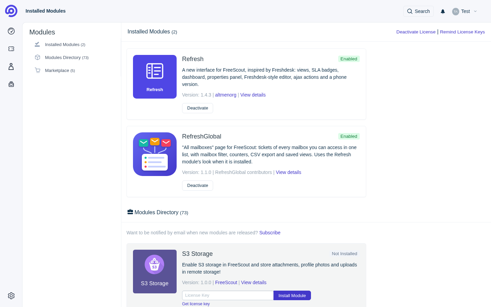

## 2. Fonctionnalités

- **Page « Toutes les boîtes »** (`/refresh-global/tickets`), dans le menu de FreeScout, dans la barre de gauche de Refresh et, sur téléphone, en tête du tiroir des vues (☰).
- **Filtre par boîte** (plusieurs boîtes à la fois), **statut**, **assignation** (moi, non assigné, un agent).
- **Recherche** : sujet, nom du client, e-mail, numéro de ticket (`#123`).
- **Boîte au-dessus de chaque ticket** : nom et adresse de la boîte (badge en vue cartes, pastille sur téléphone,
  colonne en vue tableau) ; peut être masquée dans les réglages.
- **« Mon tableau de bord » de Refresh sur toutes les boîtes** : Refresh seul n'affiche que la première boîte ; le
  module affiche le même tableau de bord (même présentation) avec les chiffres et les tickets de toutes les boîtes de
  l'utilisateur. Les tuiles mènent à « Toutes les boîtes », filtrée sur la vue Refresh correspondante.
- **Suppression d'un ticket** : retour à « Toutes les boîtes » avec les derniers filtres (ou ticket suivant de cette
  liste) ; au choix corbeille (par défaut) ou suppression définitive.
- **Compteurs** par boîte et par statut, calculés en une requête groupée.
- **Export CSV** de la liste filtrée (UTF-8 avec BOM pour Excel, nombre de lignes plafonné).
- **Vues enregistrées privées, partagées ou pour tous** (voir « Vues enregistrées et partagées » plus bas).
- Filtres dans l'adresse : un lien filtré se partage et le bouton « Retour » fonctionne.
- **Respect des droits** : chacun ne voit, ne compte et n'exporte que les tickets de ses boîtes (et seulement ses
  tickets s'il a la permission « ne voir que les conversations assignées »).
- Sur téléphone (avec Refresh) : **onglet « Toutes les boîtes »** dans la barre du bas.
- **Option « Remplacer l'entrée Tickets de Refresh »** : l'entrée « Tickets » de Refresh est masquée dans la barre de
  gauche et la barre du bas, « Toutes les boîtes » prend sa place.
- **Mises à jour** par la page **Modules** de FreeScout, ou en sécurité par le module
  [UpdateGuard](https://github.com/00MY00/UpdateGuard) (conseillé : SHA-256, sauvegarde, contrôle de santé, retour
  arrière automatique).
- **Diagnostic de compatibilité** : `php artisan refreshglobal:check` et page d'administration, avec des messages
  explicites (codes `RG-xxx`) après une mise à jour de FreeScout ou de Refresh.
- **Bouton « Relever les e-mails »** (flèche en cercle) si le module
  [SyncNow](https://github.com/rabsym/freescout-syncnow) est installé : relève tout de suite les boîtes IMAP de la
  liste, avec les droits et le délai de SyncNow.
- **Dossiers automatiques** si le module [Workflow Packs](https://github.com/00MY00/WorkflowPacks) (1.14.0 ou plus
  récent) est installé : section « Dossiers automatiques » dans le panneau des vues (arbre des dossiers de toutes
  vos boîtes, avec le nombre de tickets, un clic filtre la liste), badge dossier sur chaque ticket et page « Vue
  d'ensemble » (tickets et tickets ouverts par dossier et par boîte, dernier classement, nettoyage automatique).
- **Adresse d'envoi au choix** sur « Envoyer un e-mail » / « Nouveau ticket » : toutes les adresses de vos boîtes et
  leurs alias ; une autre boîte ouvre son formulaire en gardant ce qui est saisi ; adresse proposée selon la liste
  ou la dernière utilisée.
- **Spams laissés sur le serveur** (par défaut) et **tags de provenance** des e-mails en anglais (`inbox`, `spam`,
  `trash`, `sent`, `folder:<nom>`, `classified_spam`…) : affichés, filtrables, recalculables, lisibles par les autres
  modules et copiés dans le module Tags s'il est installé ([docs/api-tags.md](docs/api-tags.md)).
- **Détails / texte brut** de chaque message (en-têtes, Message-ID, dossier du serveur, tags).
- **Déplacer vers un dossier du serveur mail** (ticket, barre de sélection, glisser vers la gauche sur écran tactile),
  avec « Annuler » ; le ticket ne change pas, ses tags suivent le dossier.
- **Images distantes** (pixels de suivi) : toujours afficher, restrictif (bouton « Afficher les images ») ou bloqué,
  réglable finement par tag d'origine de l'e-mail.
- Traductions : français, anglais, allemand, espagnol, italien, néerlandais, portugais (Brésil).
- **Langue** : le module suit la langue de FreeScout, comme Refresh (Refresh n'a pas de choix de langue à lui) :
  celle du profil de l'utilisateur, sinon la langue par défaut (Gérer › Paramètres › Général). Un **sélecteur de
  langue** en bas du panneau des vues (et du tiroir sur téléphone) change cette langue du profil : FreeScout,
  Refresh et le module passent ensemble dans la nouvelle langue.

### Interopérabilité avec Refresh (FreeScout Interop)

RefreshGlobal et Refresh sont deux modules indépendants : chacun fonctionne sans l’autre. Ensemble, ils peuvent
coopérer par un contrat déclaré (`RefreshGlobal/interop.json`, [docs/INTEROPERABILITY.md](docs/INTEROPERABILITY.md)) :
RefreshGlobal déclare ses intentions (entrée « Toutes les boîtes », action « Déplacer », origine d’un ticket…) et
Refresh les affiche, sans que RefreshGlobal touche à sa page. Avec un Refresh qui ne connaît pas encore ce contrat,
RefreshGlobal utilise ses replis testés (mode *legacy*, comme avant). Le mode actuel est visible dans
**Diagnostic RefreshGlobal › Interopérabilité**.

Sans Refresh, RefreshGlobal garde tout : « Toutes les boîtes », vues enregistrées et partagées, filtres, et le
tableau de bord de toutes les boîtes (calculé par le module, affiché au-dessus du tableau de bord de FreeScout). Pour
les autres modules, il offre aussi une **recherche** sur toutes les boîtes (`GET /refresh-global/search`, fournisseur
`refreshglobal.global-search`) et des contextes serveur (`fsinterop.navigation.context`,
`fsinterop.conversation.context`), toujours avec les droits de l’utilisateur.

### Vues enregistrées et partagées

Une **vue** est un ensemble enregistré de filtres (boîtes, statut, assigné à, recherche, dossier automatique, tag
d'e-mail, vue Refresh) et d'un tri de « Toutes les boîtes ». Elle **ne modifie jamais un ticket** (ni statut, ni
assignation, ni dossier) et **ne donne jamais accès à une boîte**.

- **Enregistrer** : filtrer la liste, puis « Enregistrer ces filtres comme vue » (panneau des vues) : nom, puis
  **Visible par** : *Moi seul (privée)*, *Utilisateurs choisis* (liste filtrable des utilisateurs de vos boîtes ; un
  administrateur voit tous les utilisateurs et peut cocher « peut modifier ») ou *Tout le monde*.
- **Ouvrir** : sections du panneau *Vues épinglées*, *Mes vues*, *Partagées avec moi*, *Pour tous*. Changer un filtre
  garde la vue ouverte avec « * Modifications non enregistrées » : *Mettre à jour la vue* (si vous pouvez la
  modifier), *Enregistrer comme nouvelle* ou *Rétablir*. Une vue partagée n'est **jamais** modifiée sans ce clic.
- **« Moi »** : un filtre « Assigné à : moi » désigne **la personne qui regarde**. Exemple : « Mes tickets en
  attente » — *Statut : Actif + En attente*, *Assigné à : Moi* — publiée pour tous, montre à chacun ses propres
  tickets.
- **Droits** : l'auteur modifie, partage et supprime sa vue ; un administrateur peut gérer toutes les vues partagées
  ou pour tous, les rendre **vue par défaut** pour tout le monde ou pour les utilisateurs choisis, et laisser des
  utilisateurs les modifier ; les autres peuvent **la copier dans leurs vues** (si l'auteur le permet), l'épingler
  ou en faire leur vue par défaut, sans changer la vue. Réglage *Seuls les administrateurs publient des vues pour
  tous* (Gérer › Paramètres › RefreshGlobal).
- **Boîtes** : une vue « Support + Facturation » ouverte par quelqu'un qui n'a que « Support » ne montre que
  Support (avec un message) ; une boîte, un agent, un dossier ou un tag qui n'existe plus est ignoré avec un message.
- **Gérer** : page *Vues enregistrées* (`/refresh-global/views`) : toutes vos vues, ordre (↑ ↓), export / import JSON
  (les boîtes voyagent par adresse e-mail, aucun identifiant d'utilisateur), journal des vues partagées (admins).

## 3. Ce que le module ne fait pas

- Il **ne modifie pas** Refresh ni FreeScout (aucun fichier du cœur ou de Refresh n'est touché, copié ou remplacé).
- Il **ne déplace aucun ticket** : chaque ticket reste dans sa boîte d'origine.
- Il **ne gère pas les réponses** : elles se font sur la page normale du ticket, avec l'adresse de la bonne boîte.

## 4. Prérequis

| | Testé | Pris en charge |
|---|---|---|
| FreeScout | 1.8.245 | 1.8.x (avertissement en dehors) |
| Refresh (facultatif) | 1.6.0 | 1.4.0 à 1.6.x (avertissement en dehors) ; sans Refresh : style FreeScout standard |
| PHP | 8.2 | 7.1 et plus (comme FreeScout) |
| Base de données | MariaDB 10.11, MySQL 8 (installation complète) | celles de FreeScout (MySQL/MariaDB, PostgreSQL) |
| Système (installeur) | Debian 12, Ubuntu 24.04 | Linux avec bash ; installation complète : Ubuntu / Debian |

Détails et points d'intégration fragiles : [COMPATIBILITY.md](COMPATIBILITY.md).

**Windows** : la documentation officielle de FreeScout ne prend pas Windows en charge (« there is no any tutorial
yet »). Il n'y a donc pas d'installeur `install.ps1` ; sous Windows, utilisez l'installation manuelle (section 5.3).

## 5. Installation rapide

### 5.1 Ajouter le module à un FreeScout existant (une commande)

Sur le serveur FreeScout, en SSH :

```bash
curl -fsSL https://raw.githubusercontent.com/00MY00/RefreshGlobal/main/install.sh | sudo bash
```

Le script trouve FreeScout (sinon : `… | sudo bash -s -- --path=/var/www/html`), sauvegarde la base et le module,
télécharge la dernière version, l'active, vérifie la compatibilité et affiche un résumé :

```
[1/7] Contrôles préalables... OK — FreeScout 1.8.245, Refresh 1.4.3, utilisateur web www-data
[2/7] Téléchargement de RefreshGlobal (dernière version)... version 1.0.0
[3/7] Sauvegarde (base de données et module)... /var/backups/refreshglobal/20261009-140102
[4/7] Copie dans Modules/RefreshGlobal... OK
[5/7] Activation du module (migrations, lien public, caches)... OK
[6/7] Vérification de compatibilité... OK
[7/7] Résumé... OK
```

### 5.2 Installation complète sur un serveur vierge (une commande)

Sur un serveur Ubuntu ou Debian neuf, avec un nom de domaine pointant vers lui :

```bash
curl -fsSL https://raw.githubusercontent.com/00MY00/RefreshGlobal/main/install.sh | sudo bash -s -- --full
```

Le script lance **le script officiel de FreeScout** (il pose ses propres questions : domaine, confirmations
d'installation des paquets, dossier, HTTPS — sur un serveur neuf, répondre `Y` à « All files in /var/www/html will
be removed » : ce dossier ne contient que la page par défaut de nginx), vous demande de terminer l'installation
dans le navigateur (adresse `/install`), puis installe RefreshGlobal.
Pour installer aussi Refresh, téléchargez d'abord son archive officielle
([Refresh.zip](https://github.com/altmenorg/freescout-refresh/releases/latest/download/Refresh.zip)) puis :

```bash
curl -fsSL https://raw.githubusercontent.com/00MY00/RefreshGlobal/main/install.sh | sudo bash -s -- --full --refresh-zip=/root/Refresh.zip
```

Sans `--refresh-zip`, RefreshGlobal fonctionne avec le style FreeScout standard (et le dit clairement).

### 5.3 Installation sans exécuter un script téléchargé à l'aveugle

Les commandes des sections 5.1 et 5.2 envoient le script directement à `bash`. Pour **lire avant d'exécuter**,
trois méthodes :

**a) Avec Git** (recommandé : `git pull` suffit ensuite pour les mises à jour)

```bash
sudo git clone https://github.com/00MY00/RefreshGlobal.git /opt/RefreshGlobal
less /opt/RefreshGlobal/install.sh                                   # lire le script
sudo bash /opt/RefreshGlobal/install.sh --dry-run --source=/opt/RefreshGlobal/RefreshGlobal   # voir les actions, sans rien faire
sudo bash /opt/RefreshGlobal/install.sh --source=/opt/RefreshGlobal/RefreshGlobal             # installer
```

Mise à jour : `sudo git -C /opt/RefreshGlobal pull` puis
`sudo bash /opt/RefreshGlobal/install.sh --update --source=/opt/RefreshGlobal/RefreshGlobal`.

**b) Avec les fichiers de la publication** (page *Releases* du dépôt, téléchargés dans le navigateur puis copiés
sur le serveur, par exemple avec `scp`) : `RefreshGlobal.zip`, `install.sh` et `SHA256SUMS`, dans le même dossier :

```bash
sha256sum -c SHA256SUMS --ignore-missing    # RefreshGlobal.zip et install.sh doivent être « OK »
less install.sh
sudo bash install.sh --source=RefreshGlobal.zip
```

**c) Entièrement à la main**, comme pour tout module FreeScout (wiki FreeScout, « FreeScout Modules »), avec
`RefreshGlobal.zip` :

```bash
cd /var/www/html                       # dossier de FreeScout
sudo unzip ~/RefreshGlobal.zip -d Modules/
sudo chown -R www-data:www-data Modules/RefreshGlobal
```

puis **Gérer › Modules › RefreshGlobal › Activer** dans FreeScout (ou
`sudo -u www-data php artisan module:enable RefreshGlobal && sudo -u www-data php artisan freescout:module-install refreshglobal`).
Sans l'installeur, il n'y a ni sauvegarde automatique ni retour arrière.

## 6. Après l'installation

- La page : menu **« Toutes les boîtes »** (avec Refresh : icône dans la barre de gauche), ou directement
  `https://votre-helpdesk/refresh-global/tickets`.
- Vérifier que tout fonctionne :
  ```bash
  cd /var/www/html && sudo -u www-data php artisan refreshglobal:check
  ```
  Code de sortie : 0 = OK (ou avertissement), 1 = dégradé, 2 = bloquant.
- Page de diagnostic (administrateurs) : `https://votre-helpdesk/refresh-global/diagnostic`.

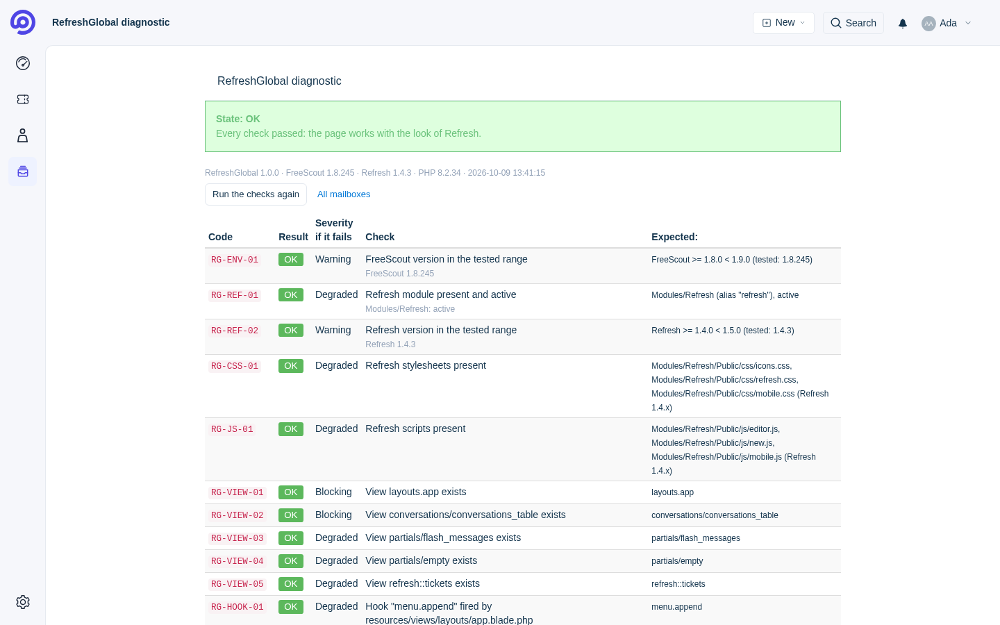

| Onglet ajouté | « Tickets » remplacé |
|---|---|
| 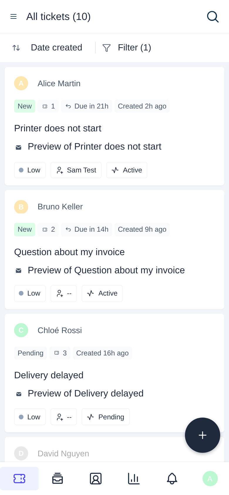 | 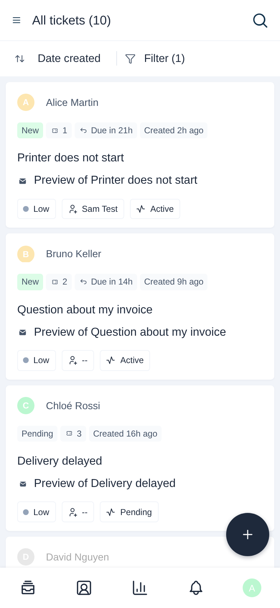 |

**Réglages du module** : **Gérer › Paramètres › RefreshGlobal** (administrateurs).

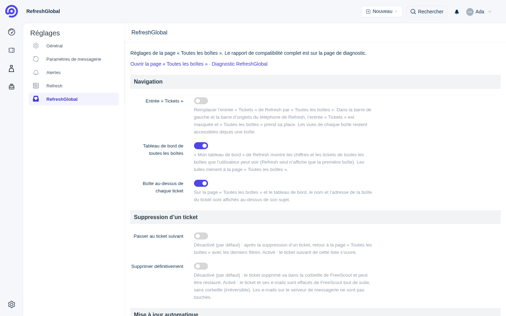

| Réglage | Par défaut | Effet |
|---|---|---|
| Entrée « Tickets » | désactivé | remplace l'entrée « Tickets » de Refresh par « Toutes les boîtes » |
| Tableau de bord de toutes les boîtes | activé | « Mon tableau de bord » de Refresh couvre toutes les boîtes de l'utilisateur ; sans Refresh, le même tableau de bord s'affiche au-dessus de celui de FreeScout |
| Objectif de première réponse / de résolution | 24 h / 72 h | objectifs SLA du tableau de bord (« En retard », « Échéance : aujourd'hui », « Résolution dans le cadre du SLA ») quand Refresh n'est pas actif ; avec Refresh, ceux de Refresh |
| Boîte au-dessus de chaque ticket | activé | nom et adresse de la boîte au-dessus du sujet (liste et tableau de bord) |
| Passer au ticket suivant | désactivé | après une suppression : désactivé = retour à « Toutes les boîtes » (derniers filtres), activé = ticket suivant de cette liste |
| Actualisation automatique | 30 secondes | la liste et le tableau de bord se mettent à jour seuls quand leurs tickets changent (jamais pendant une saisie, une sélection ou un menu ouvert) ; 0 = désactivée |
| Rester à ma place dans la liste | activé | après une suppression (depuis le ticket ou depuis la liste), « Toutes les boîtes » s'ouvre là où l'on était, le ticket suivant à la place de celui supprimé |
| Supprimer définitivement | désactivé | désactivé = corbeille de FreeScout (restaurable) ; activé = le ticket et ses e-mails sont effacés de FreeScout tout de suite (irréversible ; rien n'est touché sur le serveur de messagerie) |
| Aussi sur le serveur mail | activé | quand un ticket est supprimé définitivement, ses e-mails sont déplacés dans la corbeille du serveur mail (IMAP) dans la minute, récupérables depuis le webmail ; corbeille du serveur trouvée automatiquement ou indiquée (« Corbeille du serveur ») |
| Vider automatiquement (corbeille) | 0 jour = jamais | chaque jour à 03:45, les tickets dans la corbeille depuis plus de N jours sont supprimés définitivement avec leurs e-mails (toutes les boîtes ; serveur de messagerie non touché) |

**Vider la corbeille maintenant** : bouton « Vider la corbeille (N) » dans ces réglages et en bas du panneau des vues
de « Toutes les boîtes » (aussi sur téléphone), avec confirmation. Mêmes règles que le « Vider la corbeille » de
FreeScout : administrateurs ou utilisateurs autorisés à supprimer des conversations, seulement leurs boîtes (et leurs
tickets s'ils ne voient que les tickets assignés). Irréversible. En ligne de commande :
`sudo -u www-data php artisan refreshglobal:trash --older-than=30`.

Boutons sous les réglages : **« Rechercher une mise à jour »** (indique tout de suite si une version plus récente
existe, sans rien installer) et **« Mettre à jour maintenant »** (mise à jour sécurisée lancée dans la minute).

| Tableau de bord (toutes les boîtes) | Sur téléphone |
|---|---|
| 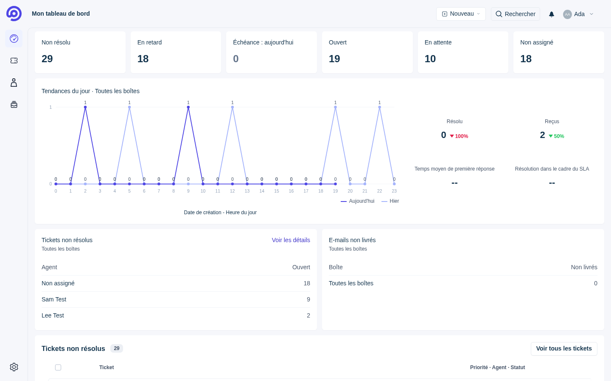 | 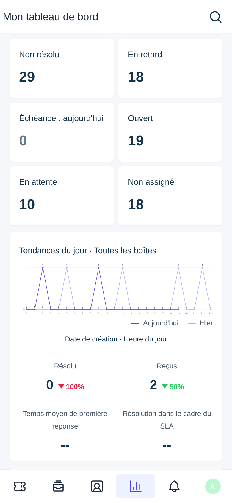 |

**Ne garder que « Toutes les boîtes »** (avec Refresh) : Gérer › Paramètres › RefreshGlobal › *Navigation*, ou page
de diagnostic › *Navigation* › « Activer ». L'entrée
« Tickets » de Refresh est alors masquée (barre de gauche et barre du bas du téléphone) et remplacée par
« Toutes les boîtes ». Les vues de chaque boîte restent accessibles depuis une boîte ; rien n'est modifié dans
Refresh, « Désactiver » remet l'entrée.

Réglages facultatifs dans le `.env` de FreeScout (puis `php artisan freescout:clear-cache`) :
`REFRESHGLOBAL_PER_PAGE` (30), `REFRESHGLOBAL_EXPORT_MAX_ROWS` (5000), `REFRESHGLOBAL_CSV_DELIMITER` (`;`),
`REFRESHGLOBAL_COMPAT_CACHE_MINUTES` (5), `REFRESHGLOBAL_MAX_SAVED_VIEWS` (50). Valeurs par défaut des réglages
avant le premier enregistrement : `REFRESHGLOBAL_GLOBAL_DASHBOARD` (true), `REFRESHGLOBAL_SHOW_MAILBOX` (true),
`REFRESHGLOBAL_AFTER_DELETE` (`list` ou `next`), `REFRESHGLOBAL_DELETE_PERMANENTLY` (false).

Avec Refresh en français, le module corrige aussi deux textes de Refresh sur téléphone (« Créé 7h il y a » →
« Créé il y a 7h », idem pour « Fermé ») sans modifier Refresh : voir `RefreshGlobal/Resources/lang/refresh-fixes.php`.

## 7. Mise à jour

**Mettre à jour RefreshGlobal** (les vues enregistrées sont conservées) :

```bash
curl -fsSL https://raw.githubusercontent.com/00MY00/RefreshGlobal/main/install.sh | sudo bash -s -- --update
```

(`--version=1.2.3` pour une version précise.)

**Depuis la 1.9.0, RefreshGlobal n'a plus de mise à jour à lui** : son `module.json` déclare les clés standard de
FreeScout (`latestVersionUrl` : `version.txt` de la dernière release, `latestVersionZipUrl` : `RefreshGlobal.zip`,
avec `SHA256SUMS` à côté). **Gérer › Paramètres › RefreshGlobal** et la page de diagnostic indiquent qui le met à
jour :

- **Avec le module [UpdateGuard](https://github.com/00MY00/UpdateGuard) (conseillé)** : il vérifie l'empreinte
  SHA-256, prépare la nouvelle version à part, sauvegarde l'ancienne, l'installe, lance le contrôle de santé du module
  (`php artisan refreshglobal:health`), **revient automatiquement en arrière** si quelque chose ne va pas, et peut
  faire les mises à jour automatiquement (réglage d'UpdateGuard). Menu **Gérer › UpdateGuard**.
- **Sans UpdateGuard** : comme les autres modules, le bouton **« Mettre à jour »** de **Gérer › Modules** apparaît
  quand une nouvelle version est publiée. Ce bouton de FreeScout ne fait **ni sauvegarde ni retour arrière** : si la
  nouvelle version ne fonctionnait pas, FreeScout désactiverait le module.
- `install.sh --update` (ci-dessus) reste disponible, avec sa sauvegarde et son retour arrière.

Contrôle de santé à la main : `cd /var/www/html && sudo -u www-data php artisan refreshglobal:health` (`--json`).

**Après chaque mise à jour de Refresh ou de FreeScout** :

1. `cd /var/www/html && sudo -u www-data php artisan refreshglobal:check`
2. lire le rapport : chaque ligne en échec donne son code, ce qui était attendu, l'effet et l'action à faire ;
3. corriger les points en échec (le plus souvent : installer la version de RefreshGlobal prévue pour la nouvelle
   version, voir [COMPATIBILITY.md](COMPATIBILITY.md)).

Tant qu'un point est en échec, la page reste sûre : style standard (état « dégradé ») ou liste masquée avec des
liens vers les boîtes (état « bloquant »).

## 8. Désinstallation et retour arrière

```bash
# désactiver le module (propose de supprimer sa table et ses fichiers ; rien d'autre n'est touché)
curl -fsSL https://raw.githubusercontent.com/00MY00/RefreshGlobal/main/install.sh | sudo bash -s -- --uninstall

# revenir à l'état d'avant la dernière installation / mise à jour
curl -fsSL https://raw.githubusercontent.com/00MY00/RefreshGlobal/main/install.sh | sudo bash -s -- --rollback
```

- Mode non interactif : `--yes` (la table est alors **conservée**, sauf `--drop-tables` ; les fichiers aussi, sauf `--remove-files`).
- Sans le script : **Gérer › Modules › RefreshGlobal › Désactiver**. Désactiver le module ne casse rien ; sa seule
  table (`refreshglobal_saved_views`) se supprime avec `php artisan module:migrate-rollback RefreshGlobal --force`.
- Sauvegardes : `/var/backups/refreshglobal/<date>/` (lisibles par root seulement) ; `--rollback=<date>` pour en
  choisir une. Le retour arrière restaure les fichiers du module et sa table, jamais toute la base (les tickets
  reçus entre-temps sont conservés) ; la sauvegarde complète `database.sql.gz` reste disponible pour une
  restauration manuelle.
- Journal : `/var/log/refreshglobal-install.log` (aucun mot de passe n'y est écrit).

## 9. Dépannage

| Code | Gravité | Cause | Solution |
|---|---|---|---|
| RG-ENV-01 | avertissement | version de FreeScout hors de la plage testée | vérifier COMPATIBILITY.md, mettre à jour RefreshGlobal |
| RG-REF-01 | dégradé | Refresh absent ou désactivé | installer / activer Refresh, ou garder le style standard |
| RG-REF-02 | avertissement | version de Refresh hors de la plage testée | vérifier COMPATIBILITY.md |
| RG-CSS-01 | dégradé | feuilles de style de Refresh introuvables (Refresh a changé) | vérifier la version de Refresh, mettre à jour RefreshGlobal |
| RG-JS-01 | dégradé | scripts de Refresh introuvables | idem |
| RG-VIEW-01…04 | bloquant / dégradé | une vue de FreeScout a disparu | mettre à jour RefreshGlobal |
| RG-VIEW-05 | dégradé | la page liste de Refresh a changé | mettre à jour RefreshGlobal |
| RG-VIEW-06 | dégradé | liste des langues de FreeScout introuvable | sélecteur de langue masqué (la langue se change dans le profil) ; mettre à jour RefreshGlobal |
| RG-HOOK-01…17 | dégradé | un hook n'est plus déclenché (menu, colonne « Boîte », icône, entrée de la barre latérale, onglet téléphone, réglages) | mettre à jour RefreshGlobal ; la liste fonctionne |
| RG-HOOK-18…20 | dégradé | tableau de bord de FreeScout ou de Refresh changé | le tableau de bord de Refresh s'affiche tel quel (première boîte) ; mettre à jour RefreshGlobal |
| RG-CORE-11 | avertissement | réglages SLA de Refresh introuvables | les objectifs SLA de RefreshGlobal s'appliquent (réglages du module) |
| RG-CORE-23, RG-DB-15 | avertissement | statuts d'envoi ou colonnes des fils de FreeScout changés | carte « E-mails non remis » et vues « Nouveaux » / « En retard » possiblement fausses |
| RG-CORE-24 | avertissement | `ConversationPolicy::view` absent | `fsinterop.conversation.context` ne donne rien sur les tickets |
| RG-HOOK-21, RG-ROUTE-04, RG-CORE-12 | dégradé | suppression d'un ticket de FreeScout changée | la suppression garde le comportement de FreeScout ; mettre à jour RefreshGlobal |
| RG-HOOK-22 | avertissement | dictionnaire des textes de Refresh changé | certains textes de Refresh sur téléphone gardent leur tournure d'origine |
| RG-CORE-01…06 | bloquant | classe / méthode / constante de FreeScout absente | mettre à jour RefreshGlobal |
| RG-HOOK-24, RG-CORE-14, 15, RG-DB-07, 08 | dégradé | suppression définitive ou accès IMAP de FreeScout changé, table du module absente | les e-mails des tickets supprimés restent sur le serveur mail ; `php artisan migrate`, sinon mettre à jour RefreshGlobal |
| RG-CORE-13, RG-DB-06 | dégradé | suppression définitive ou date d'entrée dans la corbeille de FreeScout changée | « Vider la corbeille » du module indisponible (celui de chaque boîte de FreeScout fonctionne) ; mettre à jour RefreshGlobal |
| RG-CORE-07 | dégradé | options de FreeScout illisibles | les réglages du module prennent leurs valeurs par défaut |
| RG-ROUTE-01…03 | bloquant | route introuvable | `php artisan freescout:clear-cache`, sinon mettre à jour |
| RG-DB-01…04 | bloquant | table ou colonne de FreeScout absente | `php artisan migrate` |
| RG-DB-05 | dégradé | table des vues enregistrées absente | `php artisan migrate` (les vues enregistrées sont désactivées en attendant) |
| RG-ACL-01, RG-ACL-02 | bloquant | règles d'accès de FreeScout indisponibles | mettre à jour RefreshGlobal |
| RG-ERR-01 | bloquant | erreur inattendue en construisant la page | lire `storage/logs/laravel.log` (le code y figure) |
| RG-ERR-02 | bloquant | un contrôle de compatibilité a planté | lire `storage/logs/laravel.log` |
| RG-ERR-03 | — | erreur en construisant le tableau de bord de toutes les boîtes | celui de Refresh s'affiche à la place ; lire `storage/logs/laravel.log` |
| RG-ERR-04 | — | erreur en préparant la redirection après une suppression | FreeScout redirige comme d'habitude ; lire `storage/logs/laravel.log` |

Exemples des deux états :

| Dégradé (Refresh désactivé) | Bloquant (route manquante simulée) |
|---|---|
| 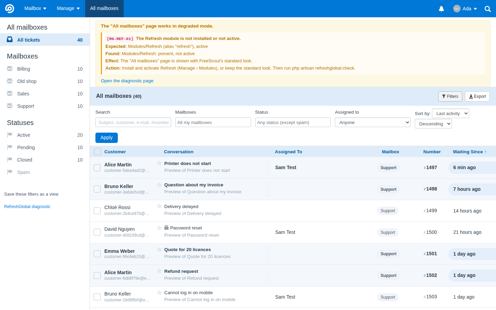 | 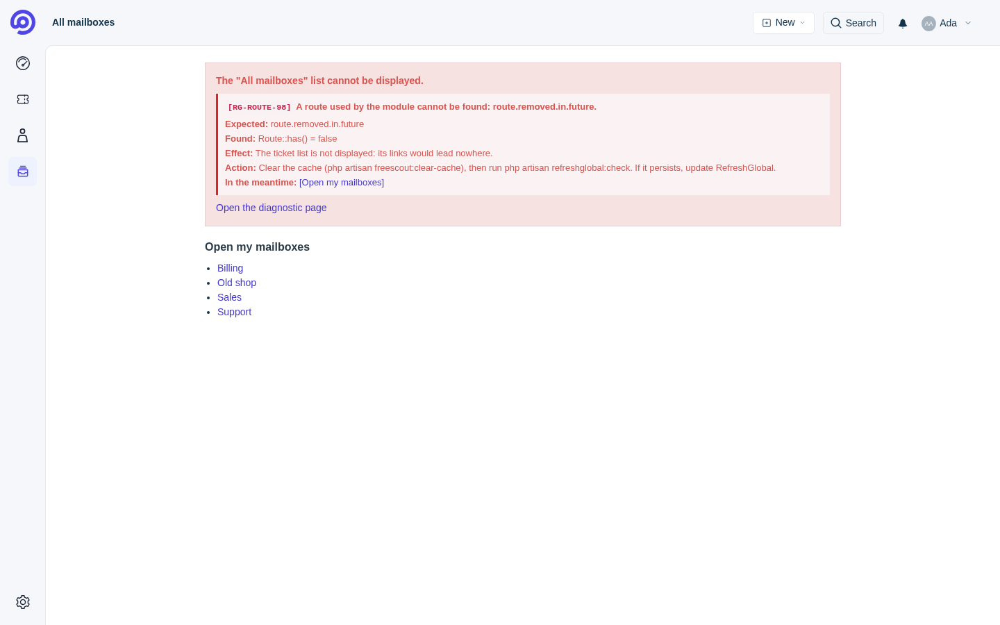 |

Problèmes d'installation : le message indique l'étape en échec, la cause et la commande de retour arrière ; le
détail est dans `/var/log/refreshglobal-install.log`.

## 10. Sécurité

- Les droits sont toujours appliqués **côté serveur** par une requête unique (`Services/GlobalTicketQuery.php`)
  pour la liste, les compteurs et l'export ; un identifiant de boîte reçu dans l'adresse n'est jamais pris tel quel
  (il est croisé avec les boîtes autorisées par FreeScout). Les boîtes archivées restent invisibles aux non-admins.
- Toutes les actions qui modifient (vues enregistrées) passent par des formulaires POST/DELETE avec jeton CSRF ; un
  identifiant de vue reçu n'est jamais pris tel quel (droit de voir, de modifier, de gérer vérifiés à chaque requête).
- L'export neutralise les formules (cellules commençant par `=`, `+`, `-`, `@`).
- **Lisez le script avant de l'exécuter** (méthodes de la section 5.3 : clone Git ou fichiers de la publication), ou utilisez
  `--dry-run`. Le script ne télécharge rien d'autre que l'archive de ce dépôt (celle de la dernière release, vérifiée
  par SHA-256 si `SHA256SUMS` est publié, ou à défaut celle de la branche `main`, en HTTPS sans empreinte) et, en mode
  `--full`, le script officiel de FreeScout ; il ne télécharge jamais Refresh.
- Signaler une faille : ouvrir un ticket privé (« Security advisory ») sur le dépôt.

## 11. Contribuer, licence, changelog

- **Contribuer** : voir [docs/CONTRIBUTING.md](docs/CONTRIBUTING.md) (structure, tests, publication).
  Les points d'intégration avec FreeScout et Refresh sont décrits dans
  [RefreshGlobal/INTEGRATION_MAP.md](RefreshGlobal/INTEGRATION_MAP.md) ; tout nouvel élément utilisé doit y être
  ajouté **et** dans `RefreshGlobal/Config/integration.php` (il sera alors contrôlé par `refreshglobal:check`).
- **Licence** : [GNU AGPL v3](LICENSE). FreeScout est sous AGPL-3.0 (`composer.json`) et Refresh aussi ; un module
  qui s'exécute dans FreeScout et utilise son code doit rester compatible : l'AGPL-3.0 est la même licence, sans
  restriction supplémentaire. Si vous proposez RefreshGlobal modifié à des utilisateurs via le réseau, vous devez leur
  donner accès à son code source.
- **Journal des modifications** : [CHANGELOG.fr.md](CHANGELOG.fr.md) (français), [CHANGELOG.md](CHANGELOG.md) (anglais).
- Tests : [tests/RESULTS.md](tests/RESULTS.md).

RefreshGlobal n'est ni affilié ni approuvé par FreeScout ou par l'auteur de Refresh.
